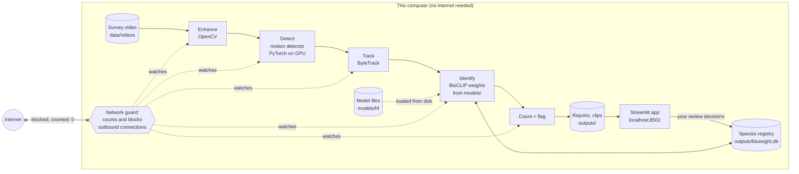

# LOCAL VERIFICATION: how we know BlueSight runs on this computer

_Generated by `scripts/local_verification.py` on 2026-11-07T05:07:56 from measured evidence. Re-run it to refresh._

## In one paragraph

BlueSight is a program that runs entirely on the laptop in front of you. The survey video is read from this computer's disk, the two AI models (one finds moving organisms, one recognises species) are files stored in this project folder, and every result is written back to this folder. No video, image or result is sent anywhere, and no online AI service (such as ChatGPT, Claude, Google or Hugging Face's hosted inference) is used. We don't just claim this: the program counts every attempt to reach the internet while it works, an automated test runs the whole analysis with the internet blocked, and the code was searched for anything that could connect out.

## How BlueSight runs locally, step by step

1. **You start the app** with `streamlit run app/streamlit_app.py`. It opens in your web browser at `http://localhost:8501`. *localhost* means "this computer": the app is configured to accept connections only from this machine, and Streamlit's usage statistics are switched off.
2. **You pick a video.** It's read straight from the disk (`data/videos/` or `outputs/uploads/`). Uploading in the app copies the file into the project folder on the same computer; nothing leaves the machine.
3. **Enhance.** Ordinary image processing (OpenCV) corrects the green cast and boosts contrast, and scores visibility. No AI.
4. **Detect.** BlueSight's motion detector compares each frame with the still background around it. It uses OpenCV and PyTorch on this computer's GPU. It has no trained weights, so there's nothing to download.
5. **Track.** ByteTrack (from the `supervision` library) follows each fish from frame to frame so it's counted once.
6. **Identify.** BioCLIP, a biology image model, turns each fish's best views into a list of numbers that are compared with the reference images of every species in the registry. BioCLIP's weights are a file in `models/hf/` that was downloaded once; on start-up BlueSight switches the model library to offline mode, so it can't download or check for updates.
7. **Count and flag.** MeanCount and MaxN are computed following Coastal Action's protocol. Anything unfamiliar goes to the review queue.
8. **Review.** Your decisions are saved in a local database file (`outputs/bluesight.db`).
9. **Throughout steps 3–7, the network guard is on.** It watches every outgoing connection. Connections inside this computer are allowed; anything else is blocked and counted. The count is saved with the results and shown on the app's **Model & privacy** page.

## Where everything lives and what runs where

| What | Where on disk | Loaded by | Runs on |
|---|---|---|---|
| Embedder fallback (if BioCLIP fails): `facebook/dinov2-small` (installed, not used by default) | `models/hf/hub/models--facebook--dinov2-small/snapshots/ed25f3a31f01632728cabb09d1542f84ab7b0056` | transformers | GPU (MPS/CUDA) or CPU |
| Open-vocabulary detector (optional, not default): `google/owlv2-base-patch16-ensemble` (installed, not used by default) | `models/hf/hub/models--google--owlv2-base-patch16-ensemble/snapshots/cfd3195ba4ea9592eec887ded089f4c08eff231d` | transformers | GPU (MPS/CUDA) or CPU |
| Open-vocabulary detector, large (experiment only): `google/owlv2-large-patch14-ensemble` (installed, not used by default) | `models/hf/hub/models--google--owlv2-large-patch14-ensemble/snapshots/95e26936e865f87db1742128404b3c035d47d89d` | transformers | GPU (MPS/CUDA) or CPU |
| Species embedder (default): `imageomics/bioclip` | `models/hf/hub/models--imageomics--bioclip/snapshots/ce901ab3c6a913f9e9ef94ce6d27761069f4f01c` | open_clip_torch | GPU (MPS/CUDA) or CPU |
| Fish detector (default): BlueSight motion detector | `src/bluesight/detect.py` | bluesight.detect (OpenCV + PyTorch median) | GPU (MPS/CUDA) or CPU |
| Tracker: ByteTrack | `.venv (supervision package)` | supervision | CPU |
| Video, results, review decisions | `data/videos/`, `outputs/` (SQLite `outputs/bluesight.db`) | OpenCV, PyAV, sqlite3 | CPU |
| The app | `app/` | Streamlit, bound to `localhost` | CPU (your browser shows it) |

This machine: **Apple M5 (Darwin arm64), device=mps**, PyTorch 2.15.0, Python 3.11.18. `device=mps` means the models run on the Apple GPU (Metal Performance Shaders).

## Data flow: the video never leaves the machine

## Evidence

### 1. Offline test (automated)

`tests/test_offline.py` blocks every connection that isn't to this computer (it patches Python's socket functions itself, independently of BlueSight's guard), then runs the **full pipeline** from scratch on a short clip: a fresh registry, real detection, BioCLIP loaded from disk, identification, evidence clips and the report.

| Result | Clip | Runtime | Frames / tracks | Blocked connection attempts | Network guard count | When |
|---|---|---|---|---|---|---|
| **PASSED** | T1-STAT2 411.MP4 1290-1302 s | 49.8 s | 24 / 121 | 0 | 0 | 2026-11-07T05:02:35 |

**Repeat it by hand with Wi-Fi off:**

1. Start the app once while online (optional; nothing is downloaded at start-up).
2. Turn Wi-Fi off (menu bar → Wi-Fi → off) and unplug any network cable.
3. `.venv/bin/streamlit run app/streamlit_app.py`, open http://localhost:8501.
4. Analyze → *Custom window* → start 1280, length 75 → **Analyze video**. Then review an item in the Review queue and open the Species registry.
5. Everything works. **Model & privacy** shows *0 external network calls during the last run*.
6. Command-line equivalent: `.venv/bin/python -m pytest tests/test_offline.py -s` (passes with Wi-Fi off too).

### 2. Network guard during real runs

Every analysis records `network.external_connection_attempts` in its `report.json`.

| Run | Generated | Mode | External attempts | Local connections | Runtime (s) |
|---|---|---|---|---|---|
| `T1_STAT2_411__60-1073s` | 2026-11-07T05:01:23 | block | **0** | 0 | 11.2 |
| `T1_STAT2_411__1073-2087s` | 2026-11-07T05:01:36 | block | **0** | 0 | 13.1 |
| `T1_STAT2_411__1280-1355s` | 2026-11-07T05:06:57 | block | **0** | 0 | 36.3 |

### 3. Code scan

`scripts/scan_network.py` searched `src`, `app`, `scripts`, `tests`, `config.yaml`, `requirements.txt`, `pyproject.toml`, `.streamlit/config.toml` for HTTP clients, raw sockets, hosted-AI SDKs, API keys, model-hub downloads, URLs and telemetry. **67 matches, 0 unexplained.**

| Kind | Matches |
|---|---|
| http client | 3 |
| raw socket | 20 |
| hosted AI SDK | 1 |
| API key / token | 1 |
| model hub load | 9 |
| URL | 10 |
| telemetry | 23 |

What was found and what was done about it:

| Found | Where | Status |
|---|---|---|
| Hugging Face model loading (`from_pretrained`, `create_model_and_transforms`) | `src/bluesight/embed.py`, `detect.py` | Loads from `models/` on disk. **Fixed in v2:** offline mode used to be set only in `load_config()`, but `huggingface_hub` reads it at import time, so it's now set in `bluesight/__init__.py` before anything else loads (plus `HF_HUB_DISABLE_TELEMETRY`). |
| Streamlit usage statistics (on by default) | Streamlit | **Disabled:** `.streamlit/config.toml` `browser.gatherUsageStats = false`. |
| Streamlit listening on all network interfaces (default) | Streamlit | **Restricted:** `server.address = "localhost"`. |
| Streamlit 'Deploy' button (links to Streamlit Cloud) | Streamlit toolbar | **Hidden:** `client.toolbarMode = "minimal"`. |
| 'Ask Google' / 'Ask ChatGPT' buttons on error messages (Streamlit default on localhost) | Streamlit error box | **Removed:** `client.showErrorLinks = false` (found while testing the app in v2). |
| Web fonts | app CSS | **Not used:** system fonts only, so the browser never contacts a font server. |
| `requests` / `httpx` / `urllib` calls, API keys, OpenAI/Anthropic/Google/Roboflow clients | project code | **None found.** |
| CodeCarbon (energy estimate) | `src/bluesight/energy.py` | Uses `OfflineEmissionsTracker` only, which has no API. Verified: 0 connections under the guard. |
| Playwright (screenshots) | `scripts/screenshot_app.py` | Development tool, talks to `localhost` only, not needed to run BlueSight. |

### 4. Model inventory

| Model | Role | Used by default | Version | Source (downloaded once) | Licence | Local path | Size on disk | SHA-256 of weights |
|---|---|---|---|---|---|---|---|---|
| `facebook/dinov2-small` | Embedder fallback (if BioCLIP fails) | no | revision ed25f3a31f01 | https://huggingface.co/facebook/dinov2-small (downloaded once) | Apache-2.0 | `models/hf/hub/models--facebook--dinov2-small/snapshots/ed25f3a31f01632728cabb09d1542f84ab7b0056` | 88.3 MB | `model.safetensors` `ae1e99fcefd534ed978cdeb8326f08030c96e28b7a81ffcbc98a857c84d14be1` |
| `google/owlv2-base-patch16-ensemble` | Open-vocabulary detector (optional, not default) | no | revision cfd3195ba4ea | https://huggingface.co/google/owlv2-base-patch16-ensemble (downloaded once) | Apache-2.0 | `models/hf/hub/models--google--owlv2-base-patch16-ensemble/snapshots/cfd3195ba4ea9592eec887ded089f4c08eff231d` | 621.5 MB | `model.safetensors` `e1e130b9e404cf91a75ad45644c1da9d7fa5284085eecc864266a6923efb99e7` |
| `google/owlv2-large-patch14-ensemble` | Open-vocabulary detector, large (experiment only) | no | revision 95e26936e865 | https://huggingface.co/google/owlv2-large-patch14-ensemble (downloaded once) | Apache-2.0 | `models/hf/hub/models--google--owlv2-large-patch14-ensemble/snapshots/95e26936e865f87db1742128404b3c035d47d89d` | 1752.1 MB | `model.safetensors` `d1c2261503c55aaf400667a843a54a5167e3c696334674c4093d6d10f7f40075` |
| `imageomics/bioclip` | Species embedder (default) | yes | revision ce901ab3c6a9 | https://huggingface.co/imageomics/bioclip (downloaded once) | MIT | `models/hf/hub/models--imageomics--bioclip/snapshots/ce901ab3c6a913f9e9ef94ce6d27761069f4f01c` | 598.6 MB | `open_clip_pytorch_model.bin` `e380384f0c30d425d8c6c40f24471f9dd497fbdfa734a89c461a94aee95f0ef4` |
| BlueSight motion detector | Fish detector (default) | yes | z=2.5, window ±8.0 s | bluesight.detect (OpenCV + PyTorch median) | project code | `src/bluesight/detect.py` | – | none (no neural network) |
| ByteTrack | Tracker | yes | supervision 0.26.1 | supervision | MIT | `.venv (supervision package)` | – | none (algorithm) |

Inventory generated 2026-11-07T05:02:41. Check a hash yourself: `shasum -a 256 <file>`.

### 5. Hardware and energy

Energy is estimated per run with CodeCarbon's **OfflineEmissionsTracker** (Nova Scotia grid carbon intensity). On this Mac it estimates CPU power from CPU load and RAM power from a model; **it can't see the Apple GPU**, so these figures are estimates and, for GPU-heavy runs, lower bounds.

| Run | Detections reused from cache? | Runtime (s) | Energy (Wh) | CO2e (g) | External connections |
|---|---|---|---|---|---|
| `T1_STAT2_411__1280-1355s` | no (full processing) | 193.2 | 1.236 | 0.712 | 0 |
| `T1_STAT2_411__1280-1355s` | yes | 38.3 | 0.373 | 0.215 | 0 |
| `T1_STAT2_411__1280-1355s` | yes | 35.3 | 0.334 | 0.193 | 0 |
| `T1_STAT2_411__60-1073s` | yes | 12.0 | 0.040 | 0.023 | 0 |
| `T1_STAT2_411__1073-2087s` | yes | 13.6 | 0.046 | 0.027 | 0 |
| `T1_STAT2_411__60-1073s` | yes | 11.2 | 0.038 | 0.022 | 0 |
| `T1_STAT2_411__1073-2087s` | yes | 13.0 | 0.044 | 0.025 | 0 |
| `T1_STAT2_411__60-1073s` | yes | 11.2 | 0.038 | 0.022 | 0 |
| `T1_STAT2_411__1073-2087s` | yes | 13.1 | 0.044 | 0.026 | 0 |
| `T1_STAT2_411__1280-1355s` | yes | 5.9 | 0.020 | 0.011 | 0 |
| `T1_STAT2_411__1280-1355s` | yes | 38.3 | 0.351 | 0.202 | 0 |
| `T1_STAT2_411__1280-1355s` | yes | 36.3 | 0.359 | 0.207 | 0 |

Runtime per minute of video for full (uncached) runs is in EVALUATION.md (§ processing time).

## Limits of this verification (honest notes)

* The network guard sees connections made by Python code inside BlueSight's process, which is where all the AI and video work happens. It can't see other programs on the computer. The Wi-Fi-off test covers everything.
* Model weights were downloaded from Hugging Face **once**, during setup. That is the only network step, and it's documented in README.md.
* Installing Python packages (`pip`/`uv`) needs the internet, once, like any software installation.
* Energy numbers are estimates from CodeCarbon's models, not a power meter, and exclude the GPU.
